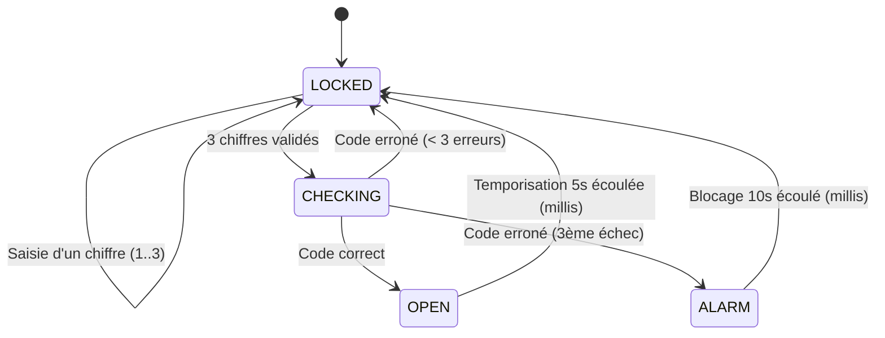

# 🔐 Coffre-fort Électronique Sécurisé
> **Fiche Projet Libre** — Système embarqué Arduino avec code secret et alarme

---

## 👥 Informations Générales

- **Nom du projet :** Coffre-fort sécurisé à code et alarme
- **Groupe :** Quentin, Nolan, Maxence, Noa et Thomas
- **Plateforme cible :** Arduino (simulateur Wokwi / platine d'essai réelle)

---

## 💡 L'idée en une phrase

> Un système de sécurité simulé permettant de verrouiller et déverrouiller un coffre grâce à une combinaison secrète (potentiomètre + validation par bouton), équipé d'une alarme visuelle et sonore en cas d'erreur répétée.

---

## 🎯 À quoi ça sert ?

| Aspect | Description |
| :--- | :--- |
| **👤 Utilisateurs cibles** | Tout particulier souhaitant protéger des objets de valeur (bijoux, documents) ou simuler un système d'accès sécurisé. |
| **🛡️ Problème résolu** | Empêcher l'ouverture non autorisée d'un compartiment tout en dissuadant les tentatives d'intrusion (*force brute*) grâce à un blocage temporaire et une alerte immédiate. |

---

## ⚙️ Comment ça marche ?

1. **État initial :** Par défaut, le coffre est verrouillé (LED rouge allumée).
2. **Saisie du code :** L'utilisateur tourne le potentiomètre pour choisir un chiffre (affiché sur le Moniteur Série) et appuie sur le bouton pour le valider.
3. **Accès autorisé :** Si les 3 chiffres saisis correspondent au code secret, le coffre s'ouvre (LED verte allumée) pendant **5 secondes** avant de se reverrouiller automatiquement.
4. **Erreur & Déclenchement d'alarme :**
   - En cas de mauvais code, une **LED orange** clignote.
   - Au bout de **3 erreurs consécutives**, le système déclenche l'alarme (LED rouge clignotante rapide + buzzer) et bloque toute nouvelle saisie pendant **10 secondes**.

---

## 🔌 Entrées et Sorties

### 📥 Entrées
| Composant | Rôle & Fonctionnement |
| :--- | :--- |
| **1× Potentiomètre** | Sélection des chiffres de `0` à `9` via la fonction `map()`. Lecture analogique avec lissage. |
| **1× Bouton poussoir** | Validation de chaque chiffre saisi ou fermeture du coffre, géré avec anti-rebond (*debounce*). |

### 📤 Sorties
| Composant | Rôle & Signification |
| :--- | :--- |
| **3× LED** | • 🟢 **Verte** : Coffre ouvert (accès autorisé) • 🟠 **Orange** : Erreur de saisie • 🔴 **Rouge** : Coffre verrouillé / Alarme active |
| **1× Buzzer piézoélectrique** | Retour sonore : bips de validation et sirène d'alarme. |
| **1× Moniteur Série** | Interface utilisateur textuelle (instructions, valeur courante du potentiomètre, messages de statut). |

---

## 🔄 Les états du système (Machine à états)

> **Contrainte technique :** Le système repose sur une machine à états stricte programmée **sans aucun `delay()` bloquant**, en utilisant exclusivement `millis()`.

### Description détaillée des états

1. **`LOCKED` (Verrouillé)**
   - Attente active de la saisie du code à 3 chiffres.
   - LED rouge fixe allumée.

2. **`CHECKING` (Vérification)**
   - Comparaison du code saisi avec le mot de passe enregistré.
   - Transition automatique vers `OPEN` ou gestion de l'erreur.

3. **`OPEN` (Ouvert)**
   - Accès autorisé avec LED verte allumée.
   - Temporisation non bloquante de **5 secondes** (via `millis()`), puis retour automatique à `LOCKED`.

4. **`ALARM` (Alarme / Bloqué)**
   - Déclenché automatiquement après **3 échecs consécutifs**.
   - Clignotement rapide de la LED rouge et sonnerie du buzzer pendant **10 secondes**.
   - Blocage complet des saisies durant ce délai, puis réinitialisation du compteur d'erreurs et retour à `LOCKED`.

---

## 👥 Répartition idéale du travail (Équipe de 5)

| Rôle | Membre | Responsabilités & Livrables |
| :--- | :--- | :--- |
| **Personne 1** | *Matériel & LED* | • Câblage complet du circuit (sur Wokwi et/ou plaque d'essai réelle). • Programmation des fonctions d'allumage et de clignotement non bloquant (`millis()`) des 3 LED (Verte, Orange, Rouge). |
| **Personne 2** | *Entrées analogiques & numériques* | • Gestion du potentiomètre (lecture, lissage exponentiel, conversion `map()` de 0 à 9). • Programmation du bouton poussoir avec fonction anti-rebond (*debounce*). |
| **Personne 3** | *Cœur logique (Machine à états)* | • Architecture globale du programme (`enum` et structure `switch/case` avec les états `LOCKED`, `CHECKING`, `OPEN`, `ALARM`). • Gestion des chronomètres internes (`stateSince`). |
| **Personne 4** | *Sécurité & Son* | • Logique de saisie du tableau de code à 3 chiffres et comparaison avec le mot de passe. • Gestion du compteur d'erreurs. • Programmation des mélodies/bips du buzzer (validation, erreur, alarme). |
| **Personne 5** | *Interface Série, Intégration & Tests* | • Affichage clair des instructions et de l'état sur le Moniteur Série. • Assemblage des modules de code de chacun dans le fichier final. • Réalisation des tests d'intégration (cas limites, rebonds, blocage d'alarme). |
